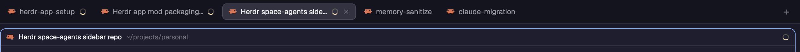

# Auto-rename

Tabs and pane headers named after each coding agent's session name, exactly as the agent sets it
(for Claude Code: the session title, including `/rename`), and nothing else. A tab with one agent
in it is called `fix-auth` instead of `2`; its pane header says `fix-auth` instead of
`Claude Code`. Tabs without an agent keep Herdr's numbers, and a name you type is never touched.

## What you see

Nothing new on screen: no panel, no button, no key. It changes two things that are already there.

- **The tab bar.** A tab holding exactly one agent with a session name shows that name, cut to
  24 characters with `…` (`Herdr app mod packaging…`). Every other tab shows what it showed
  before: Herdr's number, or the name someone gave it.
- **The pane header** (30px, at the top of every pane, `reveal: "always"`), Herdr's own `pane`
  header except for one thing: on an agent's pane the name, in `font_medium` foreground, is the
  session name, cut to 40 characters with `…`, where `pane` shows the agent's name
  (`Claude Code`). Panes whose agent has no session name, and terminals that aren't agents,
  look exactly as they do with `pane`: the program icon (14px), the program or title, the
  folder in `dim` (`~` for home), and the status at the right.

## How it behaves

- **Live.** It reacts whenever Herdr's data changes, so a `/rename` shows within a frame. No
  timer, nothing polled.
- **Agent statuses** don't change anything about the naming. The header shows them as `pane`
  does: working, a 12px ring spinner in `working` turning every 900ms; blocked, a `Needs you`
  pill (10.5px semibold, `blocked` text on `blocked` at 15% alpha); done, a 7px `done` dot;
  idle, nothing.
- **What counts as a session name.** The agent's terminal title, with leading glyphs agents put
  there (spinners, `✳`) stripped. Not a session name: an empty title; the agent's or a shell's
  default (`claude`, `claude code`, `codex`, `opencode`, `gemini`, `gemini cli`, `pi`, `zsh`,
  `bash`, `fish`, `sh`, or the agent's own `app` or program name, any case); a shell prompt
  (`user@host:~/dir`, `user@host dir`); a bare path (`~/code`, `/tmp`).
- **Which tabs it renames.** Only a tab with exactly one agent. It renames it only while the tab
  has Herdr's own number, the name this mod last gave it, or its agent's session name (now, or
  the one just before a `/rename`). So a tab named after its session follows `/rename`; any
  other name typed into a tab wins, and the mod forgets that tab.
- **Giving the number back.** When the agent leaves, exits, loses its session name, or a second
  agent joins, a tab this mod named gets Herdr's number back (`tab.rename` with `""`), and
  Herdr keeps numbering it as tabs open, close and move.
- **Clicks and hovers** on the header are `pane`'s: a click focuses the pane; hovering shows
  split right, split down, zoom (unzoom when zoomed) and close, 14px icons in `dim` that turn
  `foreground` on a `hover` background.

## Built from

Two mods, both `"place": "none"`, so they show only where a layout puts them. Neither runs
programs, reaches the network, or reads files.

- **`auto-rename`** draws nothing (`div().size_full()`) and lives in a 0px block:
  `{"id": "auto-rename", "type": "block", "size": {"px": 0}, "resizable": false,
  "content": {"mod": "auto-rename"}}`. On every render it reads `spaces()` (each tab's `id`,
  `name`, `named`) and `agents()` (`pane`, `tab`, `title`, `app`, `program.name`), and calls
  `run("tab.rename", {id, name})`, with `name: ""` for the number. It keeps the names it set in
  its `localStorage` (`"set"`: tab id → name) so it knows them after a restart, and drops tabs
  that are gone. It publishes every agent pane's session name, untruncated, with
  `setShared("auto-rename.titles", {<pane id>: <name>})`.
- **`auto-rename-pane`** is a clone of the shipped `pane` mod (`cloned_from` in its `mod.json`,
  its five icons `split-right`, `split-down`, `zoom`, `unzoom`, `close` as
  `mods/auto-rename-pane/*.svg`, and `mods/workspace-chrome/spinner.svg` from the shipped
  mod). The only change: for a pane with a `status`, the name is
  `shared("auto-rename.titles")[pane]` cut to 40, falling back to `pane`'s own name. It takes
  `props()` `{pane, terminal}` from the tab block and reads `panes()`, `theme()`, `home()`.
- **The layout's tab block** uses it as the pane header:
  `"pane": {"header": {"content": {"mod": "auto-rename-pane"}, "height": 30,
  "position": "top", "reveal": "always"}, ...}`.

The title rules are the same as `label.go` in the herdr TUI plugin at this repo's root.

## Installing it (for the agent adding it)

A mod can't add itself to a layout, and mods run only while a layout that has them is shown, so
installing is copying two folders and editing one layout.

1. Copy `mods/auto-rename/` and `mods/auto-rename-pane/` to `~/.config/herdr-app/mods/`. Leave
   this recipe and the preview out. No `keys.json`: it has no keys.
   - **Already there and it's this mod** (`auto-rename/main.js` publishes
     `"auto-rename.titles"`): that's an update. Replace the files in place; the layout is
     already wired.
   - **A different mod with one of these names:** rename the new one, and everything that
     names it: the folder, the `mod` names you put in the layout below, and for the header
     the `mods/auto-rename-pane/` paths in its `main.js`. Keep the shared key
     `"auto-rename.titles"`: it isn't a folder name.
2. Find the shown layout: `herdr-app status` → `"layout"`.
   - **One of Herdr's** (`main`, `terminals`, `win98`): those are read-only. Clone it, which
     also switches to the clone:
     `herdr-app do layout.clone '{"name":"main","as":"main-auto-rename"}'`. Edit the clone.
   - **The person's own:** edit it in place.
3. In that layout file, add the 0px `auto-rename` block above as one more child of a column or
   row that is always in the layout. In `main` (and its clones) that's the `sidebar` column,
   just before `sidebar-footer`. A hidden or folded sidebar is fine: a mod keeps running while
   its block is in the layout, shown or not.
4. Find the block with `"tab": "active"`. If its `pane.header.content.mod` is `pane` (or a
   clone of `pane`), set it to `auto-rename-pane` and leave the rest of `pane` (height,
   position, reveal, border, gap) as it was. If it's another header (`terminals-pane`, `win98`,
   one of the person's), leave it alone: tabs are still renamed, and headers are theirs. Tell
   the person, and ask before changing it. If there's no header, don't add one.
5. `herdr-app check ~/.config/herdr-app/mods/auto-rename` and
   `herdr-app check ~/.config/herdr-app/mods/auto-rename-pane`; then `herdr-app status` shows no
   `errors` and no `layouts/<name>.error`.

What it assumes: agents that set their terminal title to their session name (Claude Code does;
others that don't simply keep their tab number), and one shown layout that has the block. What
it doesn't touch: other layouts (switching to one without the block stops the renaming until
you switch back), tabs with zero or several agents, any name the person typed, space names,
keys, settings, and every shipped mod and layout. To remove it, take the block (and the header
change) out of the layout and delete the two folders; tabs it named keep their names until
renamed (`tab.rename` with `""` gives a number back).

## Watch out

- **`setShared` re-renders every mod, this one included.** Publish the titles only when they
  differ from `shared("auto-rename.titles")` (compare as JSON), or it renders forever.
- **Don't ask twice.** `tab.rename` lands a render or two later; keep the name asked for per tab
  (`asked`) and skip asking again until the tab shows it.
- **`tab.named`, not the label.** An unnamed tab's `name` is its position (`"2"`), so check
  `named` before treating a name as someone's. `tab.rename ""` is what gives the number back;
  writing the number as a name would freeze it.
- **A mod can't import another mod's code.** That's why the header reads the shared value
  instead of repeating the rules. Without `auto-rename` in the layout, the header falls back to
  `pane`'s agent name.
- **Agents put status glyphs at the start of their titles** (`✳ fix-auth`, braille spinners):
  strip leading non-letter, non-digit characters before comparing.
- **Limits:** 24 characters on a tab, 40 in a header, both counted in characters (not bytes),
  the last one replaced by `…`.

## Done when

- `herdr-app check` passes for both folders, and `herdr-app status` shows no errors.
- Starting Claude Code in a new tab and giving it a session (or `/rename fix-auth`) renames the
  tab to it within a moment, and the pane header shows the same name; a name over 24 characters
  ends in `…` on the tab and shows in full (up to 40) in the header.
- `shared("auto-rename.titles")` (in `shared.json`) has that pane's id → its session name.
- Renaming a tab by hand to something else keeps that name through later `/rename`s.
- Splitting a second agent into the tab, or exiting the agent, gives the tab its number back;
  a plain shell tab keeps its number throughout.
- A pane running a shell shows the same header as Herdr's `pane`.
